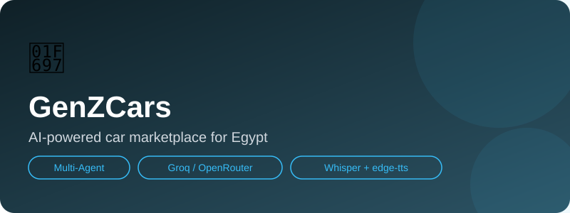
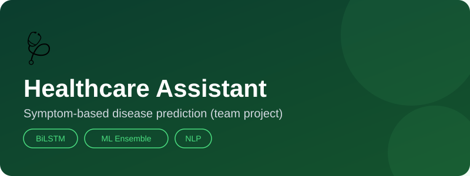

 

---

## 👋 About Me

I'm a recent computer science graduate building practical AI products, from retrieval-augmented chatbots to multi-agent systems with voice interfaces.

- 🎓 Graduated from the **Faculty of Computers & Data Science, Alexandria University**
- 🏅 Completed **DEPI (Digital Egypt Pioneers Initiative)** twice: first the **Data Science** track, then the **Generative AI** track
- 🚗 Built **GenZCars**, an AI-powered car marketplace for Egypt, as my team's DEPI graduation project
- 🤖 Focused on **RAG, LLM pipelines, hallucination guards, multi-agent architectures and voice assistants**
- 📊 Solid foundation in **data analysis, ML modelling and dashboards** from my Data Science track
- 🎮 On the side, I design and build small multiplayer games

---

## 🚀 Featured Projects

### 🚗 GenZCars: AI Car Marketplace for Egypt

> DEPI Generative AI graduation project (team)

- **Multi-agent architecture** coordinating specialised agents
- **LLM stack** with a Groq → OpenRouter fallback chain for reliability
- **Hallucination guards**: grounding and validation layers on the chatbot
- **Voice assistant** powered by Whisper (speech-to-text) and edge-tts

`Python` `LLMs` `Multi-Agent` `Groq` `OpenRouter` `Whisper` `edge-tts`

---

### 🎓 [UniQ: Arabic Student Affairs Chatbot](https://github.com/Ziad-Shalaby/uniq-chatbot)

> University graduation project

- **Arabic RAG chatbot** grounded in the faculty's official bylaws
- Runs **Qwen2.5** models (3B / 7B), with 4-bit quantisation and CPU/GPU options
- Streamlit interface plus a Google Colab notebook for fast GPU inference

`Python` `RAG` `Qwen2.5` `Streamlit` `Arabic NLP`

---

### 🩺 [Healthcare Assistant: AI Medical Diagnostics](https://github.com/Ziad-Shalaby/Healthcare_Assistant)

> Team project, where I led the model benchmarking stage

- Symptom-based **disease prediction** with generated follow-up questions
- Benchmarked ML and deep learning models (including **BiLSTM**) across three datasets
- Deployed as a Streamlit app: [Healthcare_Assistant_Deployment](https://github.com/Ziad-Shalaby/Healthcare_Assistant_Deployment)

`Python` `NLP` `BiLSTM` `Ensemble Learning` `Streamlit`

---

### 📄 [Chat with Your PDF](https://github.com/Ziad-Shalaby/chat-with-your-PDF)

- Upload any PDF and ask questions in natural language
- **FAISS** vector search + **Sentence Transformers** embeddings + **Mistral-7B-Instruct**
- 🔴 **[Live demo](https://chat-with-your-pdf-1.streamlit.app/)**

`Python` `RAG` `FAISS` `Hugging Face` `Streamlit`

---

## 📦 More Projects

| Project | What it does | Links |
|---------|--------------|-------|
| ✈️ **Airline Satisfaction** | Predicts passenger satisfaction and surfaces the key drivers | [Repo](https://github.com/Ziad-Shalaby/Airline-Satisfaction) · [Live app](https://airlinesatisfaction-deployment.streamlit.app) |
| 🎵 **Spotify Recommendation** | Similarity-based song recommender with scraped + prepared data | [Repo](https://github.com/Ziad-Shalaby/Spotify-Recommendation) · [Live dashboard](https://spotify-recommendation-dashboard.streamlit.app) |
| 🌿 **Plant Disease Detection** | Deep learning leaf-disease classifier | [Repo](https://github.com/Ziad-Shalaby/diseases_leaves_detection) · [With chat](https://github.com/Ziad-Shalaby/plant-detection-with-chat) |
| ▶️ **YouTube Summarizer** | Summarises video transcripts with a BART model | [Repo](https://github.com/Ziad-Shalaby/Youtube-summarize-app) |
| 🚕 **NYC Taxi Fare** | Regression analysis of taxi fares | [Repo](https://github.com/Ziad-Shalaby/NYC-Taxi-Fare-Regression-Analysis) |
| 🛒 **Walmart Sales Analysis** | Exploratory sales data analysis | [Repo](https://github.com/Ziad-Shalaby/Walmart-Sales-Data-Analysis-Project) |
| 🏥 **Clinic System** | Node.js web app for managing a clinic | [Repo](https://github.com/Ziad-Shalaby/web-project) |

---

## 🎮 Side Projects

A few multiplayer games I built for fun, including **[Prophecies](https://github.com/Ziad-Shalaby/prophecies-game)** (Node.js + WebSockets), **1 to 10** and **Nano Clash**, a physics-themed card game (TypeScript / React / Socket.io).

---

## 🛠️ Tech Stack

**Languages**

**Generative AI & NLP**

**Data Science & ML**

**Apps, Web & Deployment**

---

## 📊 GitHub Stats

---

## 📫 Let's Connect

 

*⭐ If you like any of my projects, a star goes a long way!*

